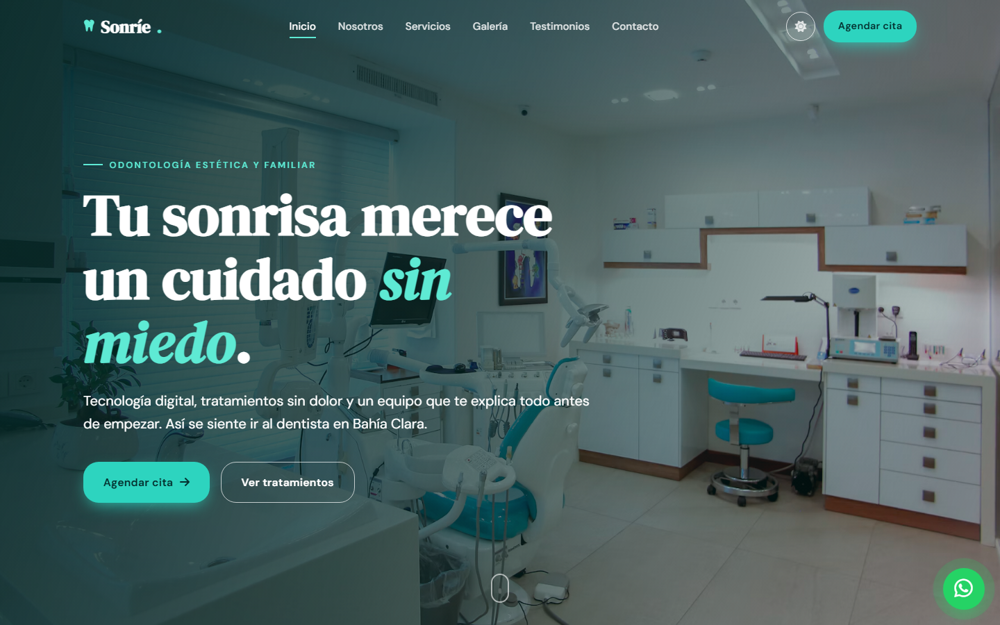

# Sonríe Dental Studio — Landing page demo

Landing page de odontología estética y familiar para un **negocio ficticio**, creada como pieza de portafolio.

## ✨ Características
- Un solo archivo `index.html` (HTML + CSS + JS), sin frameworks ni build
- 100% responsive (celular, tablet y escritorio) con menú hamburguesa animado
- Modo oscuro con toggle (recuerda tu preferencia)
- Animaciones al hacer scroll con `IntersectionObserver` y contadores animados
- Servicios en tarjetas, galería con lightbox (también con teclado) y carrusel de testimonios
- Formulario de contacto con validación en JavaScript, mapa embebido y horarios
- Botón flotante de WhatsApp
- SEO básico, Open Graph y accesibilidad (alt, foco visible, navegación con teclado, `prefers-reduced-motion`)

## 🎨 Personalización
La paleta y la tipografía están en las variables CSS de `:root` (y de `[data-theme="dark"]` para el modo oscuro), al inicio del archivo.

## 🚀 Publicación
Publicado con GitHub Pages: **Settings → Pages → Deploy from a branch → `main` / `(root)`**.

## 🛠️ Tecnologías
HTML5 · CSS3 · JavaScript (vanilla) · Google Fonts · Font Awesome · Imágenes de Unsplash

---
> Demo de diseño – negocio ficticio. Nombres, direcciones, teléfonos y testimonios son inventados.
